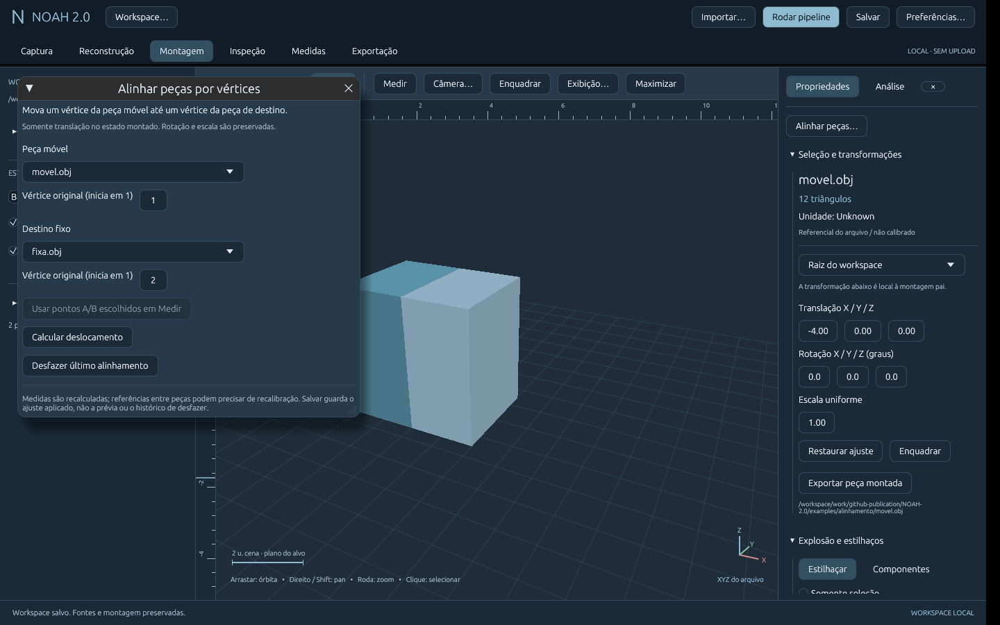
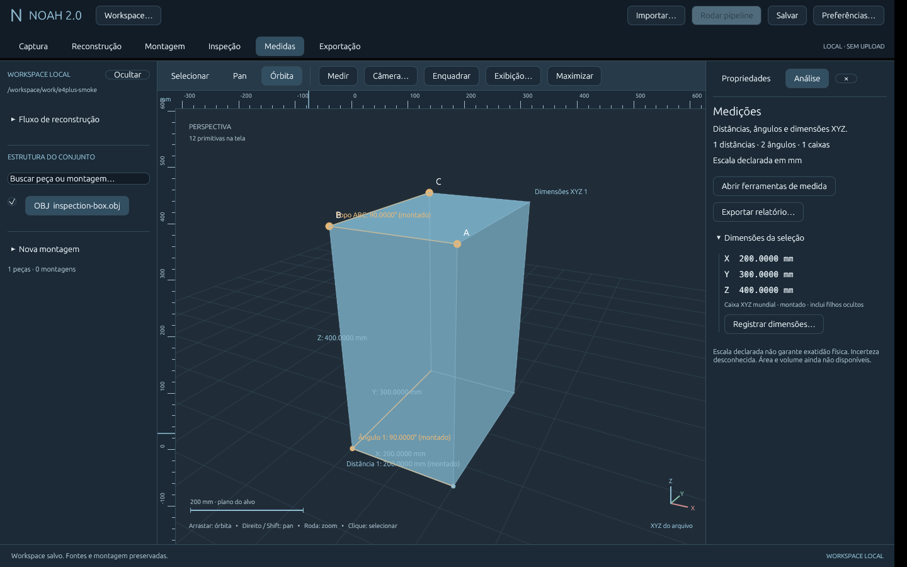
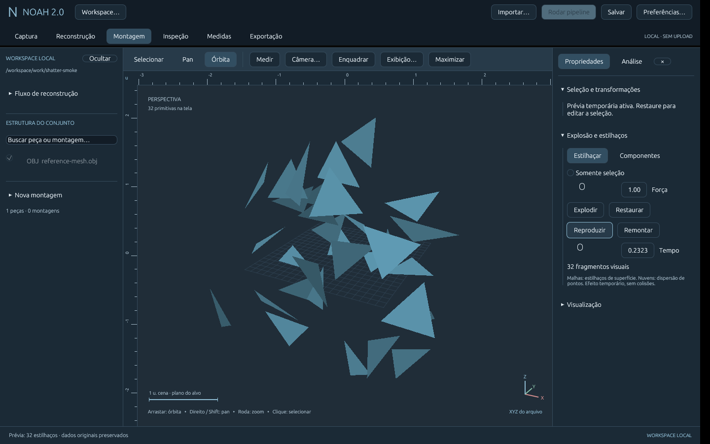
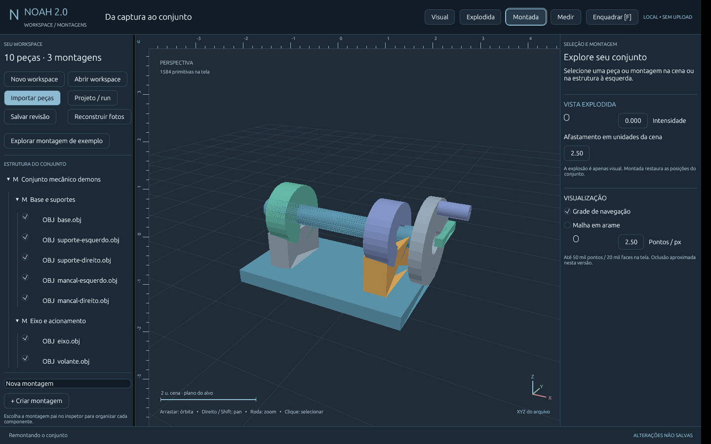

# NOAH 2.0

Plataforma 3D local-first em Rust para importar geometria, reconstruir cenas por
fotogrametria e explorar resultados em um workspace desktop.

## Estado atual

| Etapa | Estado |
|---|---|
| E1 — Fundação | PLY ASCII XYZ/RGB, transformações, projetos persistidos e CLI validados |
| E2 — Fotogrametria | COLMAP 3.11.x: sparse e superfície Delaunay CPU reais; densificação real pendente de CUDA |
| E3 — Workspace desktop | Fluxos principais pela interface, reconstrução acompanhada e sessões verificadas |
| E4 — Medições iniciais | Distâncias, ângulos ABC, dimensões XYZ, escala, anotações e relatórios; sem validação metrológica |
| Recorte E5 — Montagens | Hierarquia, alinhamento translacional por vértices, exemplo e explosão reversível |

Snapshot de desenvolvimento: 79 testes passaram em Linux x86_64. O resultado
esparso incluído contém 7.592 pontos. Não são prometidas precisão metrológica,
compatibilidade universal de formatos ou execução gráfica em todos os sistemas.

## Obter o código

```sh
git clone https://github.com/Prandini-Kaio/noah.git
cd noah
```

Também é possível baixar em **Code → Download ZIP**.

## Kit de pipeline e alinhamento E5

O pacote inclui **12 imagens sintéticas**, uma nuvem histórica pré-processada e
duas malhas para alinhamento. Em Reconstrução, **Usar fotos do kit**
seleciona os dados; indique seu COLMAP 3.11.x e um destino novo. O fluxo esparso
real foi novamente validado pela CLI e interface com 12/12 imagens registradas.
Sem COLMAP, **Abrir nuvem pronta** permite testar a inspeção sem reconstruir.

Em Workspace → Abrir peças de alinhamento do kit → Montagem → Alinhar peças,
use movel.obj/1 → fixa.obj/2: ΔX=-4 u. cena. Prévia não modifica o conjunto;
Aplicar ajusta a instância; Desfazer é protegido contra alterações posteriores.
É alinhamento translacional, sem rotação automática/ICP ou restrições CAD.

Estilhaços agora são menores (768 por caixa simples no detalhe padrão), com maior
dispersão e acompanhamento de câmera. Arame voltou a ser **sem preenchimento**;
sobrepor arestas ao sólido é uma opção independente.
[Guia do kit e limites](docs/desktop/E5-KIT-PIPELINE.md).



## Inspeção E4: ângulos e dimensões

Em **Medidas**, use Distância, Ângulo (ABC no vértice B) ou Dimensões XYZ.
Seleção por snap ou índices originais; as caixas usam todos os vértices da peça
ou montagem, incluindo filhos ocultos, no estado montado. Ângulos independem da
calibração; comprimentos físicos exigem uma escala válida.

O pacote Linux inclui `examples/inspection-box.obj`: caixa de 2×3×4 u. cena,
ângulo 6–5–8 = 90°. Declarar 200 mm na aresta 2–1 resulta em 200×300×400 mm.
Sessão 5 lê as versões 1–4; relatório 2 inclui fontes, âncoras e transformações.
[Guia e limites](docs/desktop/E4-INSPECAO.md).



## Workspace reorganizado e estilhaços

Navegue por Captura, Reconstrução, Montagem, Inspeção, Medidas e Exportação sem
perder a cena. A estrutura tem busca; painéis laterais são redimensionáveis e
ocultáveis; o inspetor reúne propriedades, análise e seções recolhíveis.

Em **Montagem → Explosão e estilhaços → Estilhaçar → Explodir**, até uma malha
única se dispersa em fragmentos visuais com rotação. Pause, ajuste o tempo,
remonte ou restaure instantaneamente. O modo **Componentes** conserva a vista
explodida técnica. A prévia não altera fontes, exportação ou medições e não é
salva na sessão. [Guia e limites](docs/desktop/ESTILHACOS-LAYOUT.md).



## Arctic: interface e visualização

Arctic Dark é o padrão; Arctic Light está em **Preferências → Tema e opções visuais**. Explosão e remontagem
agora têm transição animada, com opção de movimento reduzido. O menu **Exibição** também
reúne projeção ortográfica, vistas frontal/superior/lateral, réguas calibradas,
eixos e controles de seleção. **Medir** oferece snap frontal e entrada por
índice original, coordenadas/deltas e casas decimais de exibição.

[Guia Arctic e limites](docs/desktop/ARCTIC.md). Réguas em perspectiva valem no
plano do alvo; em ortográfica a escala é uniforme. Não garantem exatidão física.



## Usar a interface no Linux

Baixe a prévia compilada em [Releases](https://github.com/Prandini-Kaio/noah/releases),
extraia a pasta e abra **NOAH** com duplo clique. Não precisa de Rust/Cargo para
usar esse binário. Requer Linux x86_64, glibc 2.39+ e X11/XWayland com OpenGL.
[Instruções detalhadas](docs/desktop/LEIA-ME-LINUX.txt).

- **Explorar montagem de exemplo** cria fontes de dez peças em pasta escolhida.
- **Montada / Explodida** e o controle de intensidade alteram apenas a visualização.
- **Criar montagem** e o inspetor permitem organizar e transformar componentes.
- **Importar peças / Projeto-run** e **Abrir workspace** usam explorador integrado.
- **Salvar revisão** preserva câmera, hierarquia, ajustes e explosão em arquivo novo.
- **Medir** seleciona vértices A/B, registra distâncias e define uma referência de escala em mm/m. Medidas e referência acompanham a sessão.
- **Reconstruir fotos** escolhe fotos, COLMAP e destino; acompanha etapas/logs,
  cancela o processamento e abre o resultado no workspace.

Fontes são referenciadas por caminhos absolutos: não mova seus arquivos depois de
salvar. A montagem é manual e o renderer mantém oclusão aproximada; não é CAD.
O pacote não inclui COLMAP, necessário apenas para reconstrução por fotografias.


## Compilar e executar para desenvolvimento


Requer Rust estável (validado com 1.99.1) e linker C. O app desktop requer display
X11 e OpenGL; Linux é o único alvo validado nesta versão. COLMAP não é necessário
para abrir os exemplos inclusos.

```sh
cargo test --workspace --locked
cargo run --locked -p noah-desktop -- examples/e2-sparse/sparse.ply
cargo run --locked -p noah-desktop -- tests/datasets/reference-mesh.obj
cargo run --locked -p noah-cli -- --help
```

No desktop: arrastar para órbita, botão direito/Shift para pan, roda para zoom e
F para enquadrar. Clique na geometria ou lista para selecionar; ajuste instâncias
no inspetor. Salve cada sessão com um nome novo. As fontes são preservadas.

O renderer inicial usa projeção CPU e desenho OpenGL/egui, ordenação aproximada
por profundidade e amostra de até 50 mil pontos/20 mil faces. Não possui z-buffer
3D, edição topológica ou CAD.

## Preparação e limpeza — prévia v0.9

**Reconstrução → Preparar imagens…** analisa detalhe/desfoque possível, exposição,
resolução e duplicatas exatas. Revise a seleção e salve um preparo em pasta nova.
É possível manter os arquivos originais ou redimensionar proporcionalmente para
PNG; o pipeline passa a usar essas cópias e registra sua proveniência. Avisos são
heurísticos, sem exclusão automática. Sem máscara ou correção fotométrica.

**Limpar nuvem… → Editar nuvem selecionada** oferece seleção por retângulo em toda
a profundidade ou caixa XYZ local, remover/isolar, filtros SOR e por raio, prévia
em vermelho, comparação e desfazer. **Salvar e abrir revisão limpa** cria outra
fonte com índices originais, cores, hashes e receita; não muda medidas antigas.
Até 200 mil pontos. Exemplo: `examples/limpeza/nuvem-com-outliers.ply` (348 pontos,
5 outliers conhecidos). [Passo a passo](docs/desktop/PREPARO-LIMPEZA.md).

Para a próxima etapa, selecione a revisão limpa de um **run sparse** e use
**Reconstrução → Usar run selecionado para gerar malha → novo destino → Gerar
malha do run**. As relações com câmeras/observações são filtradas junto dos
pontos; o pai fica intacto. PLY isolado pode ser editado, mas não substitui as
câmeras necessárias ao Delaunay. Se o run já abrir como malha, use **Abrir nuvem
esparsa do run selecionado**. Sessão 7 lê 1–6; relatório JSON 4.

## Superfície 3D — prévia v0.8

Em **Reconstrução**, selecione **Malha rápida da esparsa · CPU** para gerar uma
superfície junto da reconstrução. Para continuar uma nuvem já processada, abra o
**diretório do run**, selecione-o na árvore e escolha **Usar run selecionado para
gerar malha**. Informe COLMAP 3.11.x, pasta e nome novos; use **Gerar malha do run**
e depois **Abrir malha no workspace**. Um PLY isolado não contém as câmeras
necessárias; nesse caso é necessário o run original ou reprocessar as fotos.

**Abrir superfície pronta** carrega um resultado real pré-processado do kit,
sem executar COLMAP. A malha tem faces e admite wireframe, inspeção e exportação
OBJ. É uma aproximação sem textura UV, pode incluir fundo/buracos e não é sólido
CAD. Unidades físicas e precisão permanecem desconhecidas. Sessão 7 lê 1–6 e
preserva as fontes antigas como nuvens; relatório JSON passa a versão 4.

## Reconstrução com COLMAP

Instale COLMAP **3.11.x** separadamente, pelas
[instruções oficiais](https://colmap.github.io/install.html), e informe o caminho
do executável local confiável:

```sh
cargo run --locked -p noah-cli -- reconstruct ./fotos ./novo-run --colmap /caminho/colmap --timeout 600
cargo run --locked -p noah-cli -- run-inspect ./novo-run
cargo run --locked -p noah-cli -- mesh-from-run ./novo-run ./nova-malha --colmap /caminho/colmap
# Ou acrescente --mesh a reconstruct para obter fotos → superfície diretamente.
```

O diretório plano de fotos aceita 3–500 JPEG/PNG. O run deve ser novo e registra
cópias das fotos, hashes, versão do motor, parâmetros, etapas e logs. Unidade
permanece desconhecida e o referencial SfM é arbitrário. Para densificação use
`--dense`; requer COLMAP com CUDA e GPU compatível. Essa etapa não foi validada
com hardware real nesta entrega. Não há download de dados nem telemetria do NOAH.

## Documentação

- [Pacote e instruções](LEIA-ME-PACOTE.md)
- [Relatório E1](docs/quality/E1-REPORT.md)
- [Relatório E2](docs/quality/E2-REPORT.md)
- [Preparação, limpeza e superfície limpa — relatório atual](docs/quality/PREPARO-LIMPEZA-REPORT.md)
- [Superfície CPU — relatório anterior](docs/quality/E2-MALHA-REPORT.md)
- [Ajustes/E5/kit de pipeline — relatório](docs/quality/E5-KIT-REPORT.md)
- [E4: ângulos e dimensões — relatório](docs/quality/E4-INSPECAO-REPORT.md)
- [Estilhaços e layout — relatório](docs/quality/ESTILHACOS-REPORT.md)
- [Arctic — relatório](docs/quality/ARCTIC-REPORT.md)
- [Medições e escala — relatório](docs/quality/E4-REPORT.md)
- [Interface integrada e montagem — relatório](docs/quality/INTERFACE-MONTAGENS-REPORT.md)
- [Relatório E3 histórico](docs/quality/E3-REPORT.md)
- [Roadmap](docs/roadmap/ROADMAP.md)
- [Arquitetura](docs/architecture/BOUNDARIES.md)
- [Decisões técnicas](docs/decisions/)
- [Dependências E3](docs/quality/THIRD-PARTY-E3.md)

## Licenças

Código original do projeto: **MIT**, conforme [LICENSE](LICENSE).
Datasets sintéticos e cenas de exemplo: **CC0-1.0**, conforme seus READMEs.
Dependências conservam suas próprias licenças e avisos em
[docs/quality/third-party-licenses](docs/quality/third-party-licenses/).
COLMAP e seu ambiente não são distribuídos neste repositório.
