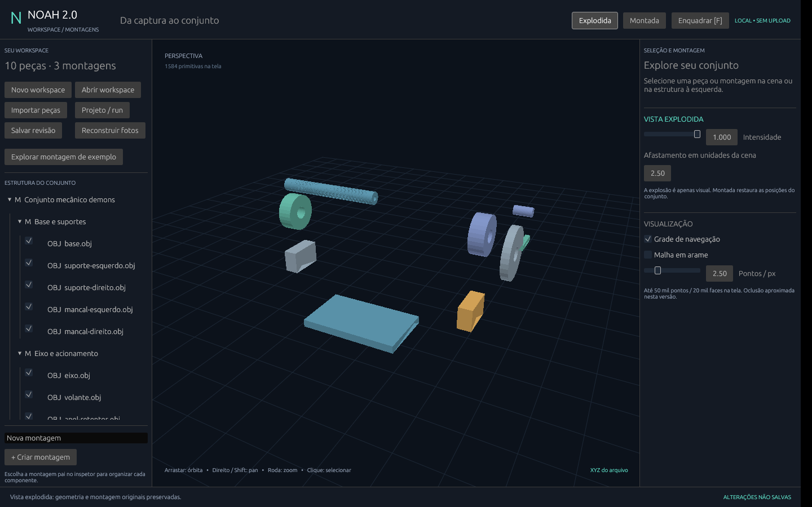

# NOAH 2.0

Plataforma 3D local-first em Rust para importar geometria, reconstruir cenas por
fotogrametria e explorar resultados em um workspace desktop.

## Estado atual

| Etapa | Estado |
|---|---|
| E1 — Fundação | PLY ASCII XYZ/RGB, transformações, projetos persistidos e CLI validados |
| E2 — Fotogrametria | COLMAP 3.11.x esparso validado com 12 imagens sintéticas; densificação real pendente de CUDA |
| E3 — Workspace desktop | Fluxos principais pela interface, reconstrução acompanhada e sessões verificadas |
| E4 — Medições iniciais | Distâncias entre vértices, escala declarada, anotações e relatórios; sem validação metrológica |
| Recorte E5 — Montagens | Hierarquia manual, exemplo de dez peças e vista explodida reversível |

Snapshot de desenvolvimento: 35 testes passaram em Linux x86_64. O resultado
esparso incluído contém 7.592 pontos. Não são prometidas precisão metrológica,
compatibilidade universal de formatos ou execução gráfica em todos os sistemas.

## Obter o código

```sh
git clone https://github.com/Prandini-Kaio/noah.git
cd noah
```

Também é possível baixar em **Code → Download ZIP**.

## Usar a interface no Linux

Baixe a prévia compilada em [Releases](https://github.com/Prandini-Kaio/noah/releases),
extraia a pasta e abra **NOAH** com duplo clique. Não precisa de Rust/Cargo para
usar esse binário. Requer Linux x86_64, glibc 2.39+ e X11/XWayland com OpenGL.
[Instruções detalhadas](docs/desktop/LEIA-ME-LINUX.txt).

- **Explorar montagem de exemplo** cria fontes de dez peças em pasta escolhida.
- **Montada / Explodida** e o controle de intensidade alteram apenas a visualização.
- **Criar montagem** e o inspetor permitem organizar e transformar componentes.
- **Importar peças / Projeto-run** e **Abrir workspace** usam explorador integrado.
- **Salvar revisão** preserva câmera, hierarquia, ajustes e explosão em arquivo novo.
- **Medir** seleciona vértices A/B, registra distâncias e define uma referência de escala em mm/m. Medidas e referência acompanham a sessão.
- **Reconstruir fotos** escolhe fotos, COLMAP e destino; acompanha etapas/logs,
  cancela o processamento e abre o resultado no workspace.

Fontes são referenciadas por caminhos absolutos: não mova seus arquivos depois de
salvar. A montagem é manual e o renderer mantém oclusão aproximada; não é CAD.
O pacote não inclui COLMAP, necessário apenas para reconstrução por fotografias.



## Compilar e executar para desenvolvimento


Requer Rust estável (validado com 1.99.1) e linker C. O app desktop requer display
X11 e OpenGL; Linux é o único alvo validado nesta versão. COLMAP não é necessário
para abrir os exemplos inclusos.

```sh
cargo test --workspace --locked
cargo run --locked -p noah-desktop -- examples/e2-sparse/sparse.ply
cargo run --locked -p noah-desktop -- tests/datasets/reference-mesh.obj
cargo run --locked -p noah-cli -- --help
```

No desktop: arrastar para órbita, botão direito/Shift para pan, roda para zoom e
F para enquadrar. Clique na geometria ou lista para selecionar; ajuste instâncias
no inspetor. Salve cada sessão com um nome novo. As fontes são preservadas.

O renderer inicial usa projeção CPU e desenho OpenGL/egui, ordenação aproximada
por profundidade e amostra de até 50 mil pontos/20 mil faces. Não possui z-buffer
3D, edição topológica, CAD ou ferramentas de medição nesta etapa.

## Reconstrução com COLMAP

Instale COLMAP **3.11.x** separadamente, pelas
[instruções oficiais](https://colmap.github.io/install.html), e informe o caminho
do executável local confiável:

```sh
cargo run --locked -p noah-cli -- reconstruct ./fotos ./novo-run --colmap /caminho/colmap --timeout 600
cargo run --locked -p noah-cli -- run-inspect ./novo-run
```

O diretório plano de fotos aceita 3–500 JPEG/PNG. O run deve ser novo e registra
cópias das fotos, hashes, versão do motor, parâmetros, etapas e logs. Unidade
permanece desconhecida e o referencial SfM é arbitrário. Para densificação use
`--dense`; requer COLMAP com CUDA e GPU compatível. Essa etapa não foi validada
com hardware real nesta entrega. Não há download de dados nem telemetria do NOAH.

## Documentação

- [Pacote e instruções](LEIA-ME-PACOTE.md)
- [Relatório E1](docs/quality/E1-REPORT.md)
- [Relatório E2](docs/quality/E2-REPORT.md)
- [Medições e escala — relatório atual](docs/quality/E4-REPORT.md)
- [Interface integrada e montagem — relatório](docs/quality/INTERFACE-MONTAGENS-REPORT.md)
- [Relatório E3 histórico](docs/quality/E3-REPORT.md)
- [Roadmap](docs/roadmap/ROADMAP.md)
- [Arquitetura](docs/architecture/BOUNDARIES.md)
- [Decisões técnicas](docs/decisions/)
- [Dependências E3](docs/quality/THIRD-PARTY-E3.md)

## Licenças

Código original do projeto: **MIT**, conforme [LICENSE](LICENSE).
Datasets sintéticos e cenas de exemplo: **CC0-1.0**, conforme seus READMEs.
Dependências conservam suas próprias licenças e avisos em
[docs/quality/third-party-licenses](docs/quality/third-party-licenses/).
COLMAP e seu ambiente não são distribuídos neste repositório.
