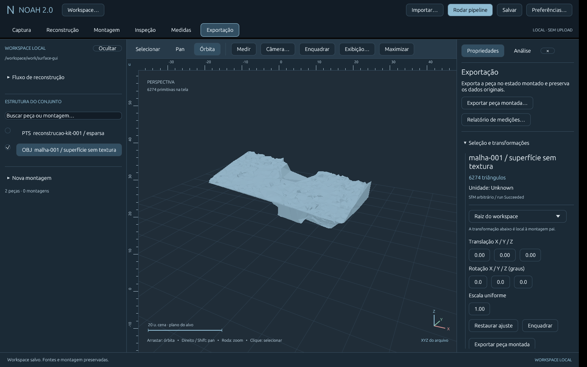

# Continuação E2 — superfície, 2026-11-13

Objetivo autorizado: continuar fotos/nuvem até superfície 3D e disponibilizar na
interface. Não declara E2 densa nem E5 completas.

## Implementação e decisões
Storage: parser limitado de PLY COLMAP ASCII/little-endian, normais/RGB/densidade,
triângulos e normalização OBJ. Adapter: Delaunay sparse CPU, Poisson pós-dense,
proveniência e derivação de run em nova pasta com hashes conferidos. CLI:
reconstruct --mesh e mesh-from-run; desktop: quatro modos, reaproveitar run,
abrir superfície ou nuvens, exemplo de malha real. Workspace: fonte RunSurface,
sessão 6 compatível com 1–5 e relatório 3. ADR 0011 registra identidade e limites.
Nenhuma dependência adicionada. Originais não são alterados.

## Evidências executadas
- cargo fmt --all -- --check: passou.
- cargo clippy --workspace --all-targets --locked -- -D warnings: passou.
- cargo test --workspace --locked: **67 testes**, zero falhas.
- cargo build --release --workspace --locked: passou.
- COLMAP 3.11.1 real, fotos do kit → Delaunay CPU: 12 imagens registradas,
  7.596 pontos esparsos, **3.324 vértices / 6.628 faces** na malha.
- Run anterior → nova malha CLI: **3.267 vértices / 6.516 faces**;
  somente verificar motor, restaurar modelo e gerar malha, sem repetir SfM.
- Interface nativa X11/Mesa: sessão antiga aberta com nuvem/medida, derivação
  executada pela janela, malha aberta com **3.146 vértices / 6.274 faces**;
  nuvem original preservada, sessão 6 salva e reaberta no pacote compilado, OBJ exportado
  com 3.146 vértices/6.274 faces e relatório JSON 3 conferido.
  Hash do manifesto pai coincide com a sessão antiga; snapshots parent-run.json
  das duas derivações são idênticos aos manifestos originais.
- Poisson CPU isolado real: caixa analítica com 2.400 pontos/normais, depth 6,
  trim 0, 2 threads → **5.409 vértices / 10.748 faces**. PLY → OBJ → leitura
  conferida. Isso não valida densificação de fotografias em GPU.
- Testes cobrem quatro modos com motor controlado, erros/mesh inválida sem
  ocultar sparse, origem adulterada rejeitada antes de criar destino, PLY
  inválido/limites e identidade/âncoras de sessão antiga mantidas como nuvem.



## Demo reproduzível
Instalar COLMAP 3.11.x separadamente. No pacote Linux: Reconstrução → Usar fotos
do kit → escolher COLMAP → pasta e nome novos → Malha rápida da esparsa · CPU →
Iniciar pelas fotos → Abrir malha no workspace. Para run existente: abrir a pasta
por Projeto/run, selecionar fonte → Usar run selecionado para gerar malha →
novo destino → Gerar malha do run. Sem motor: Abrir superfície pronta.

CLI equivalente:
```sh
noah reconstruct examples/pipeline/fotos ./novo-run --colmap /caminho/colmap --mesh --timeout 180
noah mesh-from-run ./novo-run ./nova-malha --colmap /caminho/colmap --timeout 180
```
Contagens podem variar entre execuções. O exemplo pronto registra sua origem e
hashes; não usa as malhas independentes de alinhamento como reconstrução.

## Aceite e pendências
Conforme: CPU real de fotos até superfície, reutilização rastreável, originais,
parsers, identidade de sessão, UI e exportação. Densificação GPU a partir de
fotos permanece sem validação real; requer CUDA. Superfície sparse é aproximada,
inclui fundo e pode ter buracos/artefatos. Sem textura UV, separação em peças,
fechamento garantido, CAD ou precisão metrológica. Renderer ainda tem profundidade
aproximada e amostragem. Próximos passos propostos: validar dense em GPU, melhorar
qualidade/limpeza e avaliar textura UV; não executados nesta entrega.
