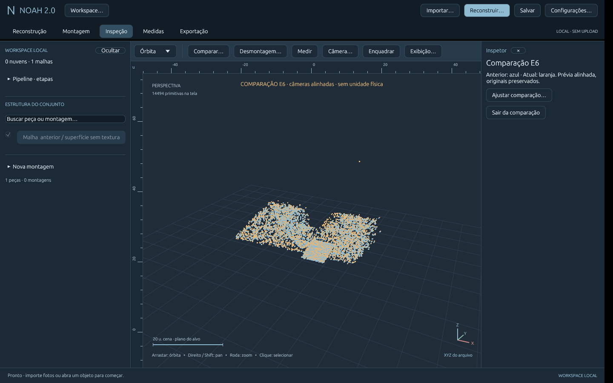

# E6 inicial — revisão de captura e comparação, 2026-11-15

Escopo autorizado: resumo das pendências e execução da próxima etapa. Plano:
../roadmap/E6-REVISOES.md; ADR 0014; guia ../desktop/E6-GUIA.md.

## Implementação
Novo run combina snapshots anteriores e fotos adicionais únicas por SHA-256.
Preserva o pai, copia seu manifest e registra origens/hashes em refinement.json.
Reprocessa SfM completo, com as saídas sparse/dense/superfície já existentes.
CLI: refine-run e compare-runs. Desktop: modo de novas fotos no passo Configurar,
worker/cancelamento/status e comparação em ferramenta separada.

Similaridade positiva com rotação própria alinha câmeras por identidade das fotos.
Exige quatro câmeras comuns não colineares e residual <=5% do raio de referência.
Comparação sparse bidirecional por vizinho próximo, até 20k consultas/200k alvos
por sentido; amostragem explícita, limiar, média/RMS/P50/P95/máximo/fração próxima.
Relatório JSON schema 1 reabre verificando hashes e recalculando. Prévia descartável
com antes/depois/sobreposição/diferenças, sem substituir a geometria do workspace.
Sessão 8 e relatório geométrico 4 inalterados. Nenhuma dependência nova.

## Verificações
Linux x86_64, Rust 1.99.1, COLMAP 3.11.1 CPU, Xorg/Mesa.
Fmt, clippy com warnings negados, 91 testes de workspace e build release passaram.
Testes novos cobrem transformação conhecida, dados degenerados/ruído, vizinho
próximo versus força bruta, deduplicação/proveniência/pai intacto, comparação com
diferença conhecida, relatório reaberto, adulteração, não sobrescrita e falta de
câmeras comuns.

Comandos reais (destinos novos):
```
noah reconstruct examples/refinamento/base BASE --colmap COLMAP --mesh
noah refine-run BASE examples/refinamento/adicionais NOVA --colmap COLMAP --mesh
noah compare-runs BASE NOVA comparacao.json
```
Base: 10/10 fotos registradas, 6.889 pontos sparse, 6.183 faces de superfície.
Revisão CLI: 12/12 fotos, 7.605 pontos, 6.564 faces. Dez câmeras comuns;
residual normalizado 0,0592%, escala relativa 0,996269. Estatísticas são em
unidades arbitrárias; mais pontos não demonstram melhoria de precisão.
Os dois runs prontos do kit são estes resultados reais; snapshots, manifests e
artefatos registrados preservam os bytes originais. DB/intermediários não
registrados omitidos; caminhos históricos na proveniência não são portáteis.

A interface executou outra revisão real com duas fotos adicionais: 12/12
registradas, 7.629 pontos, residual normalizado 0,044% contra a mesma base.
O passo Processar transitou para Resultados e o botão de comparação preencheu
os dois runs. A primeira inspeção visual revelou índice de seleção incorreto
na segunda nuvem da prévia; corrigido para não consultar a seleção do workspace
original durante a comparação. A prévia foi novamente verificada no pacote.

## Limites e backlog
Comparação usa sparse bruto, não revisões limpas, malhas ou distâncias de superfície.
Sem transferência automática de escala, limpeza ou transformações. Não há
incrementalidade, ganho garantido ou validação metrológica. Alinhamento por câmeras
não equivale a ICP geral. CUDA real, textura e qualidade de superfície; primitivas
e ensaios físicos; rotação/ICP/instâncias; sensores e CAD continuam pendentes.

Pacote final abriu o kit pronto pela interface, calculou 10 câmeras comuns e
14.494 pontos na sobreposição, exibiu o inspetor de comparação e retornou à malha
original pelo botão Sair da comparação. Nenhum motor foi necessário nesse teste.

