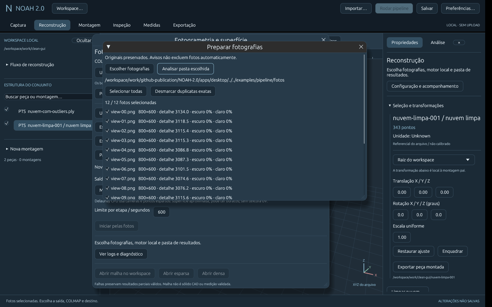
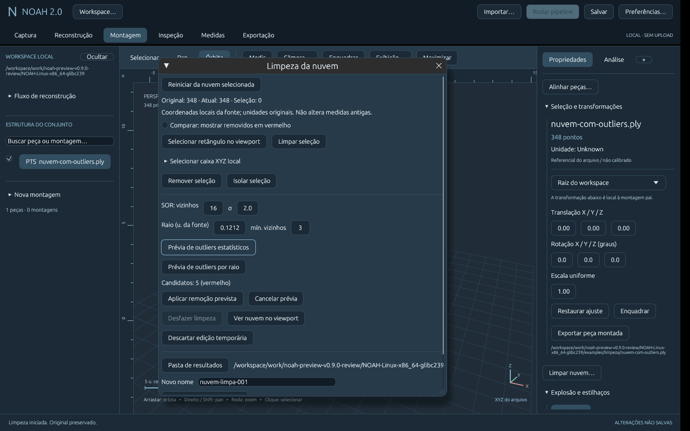
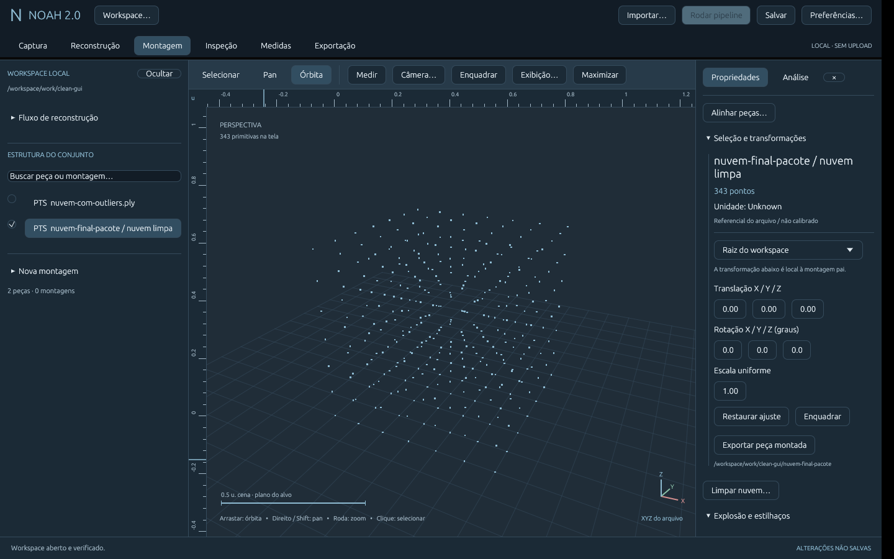
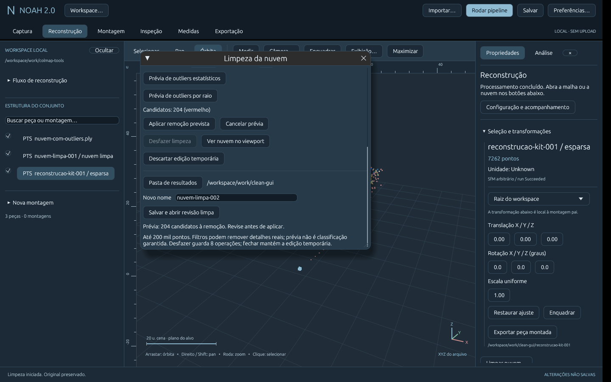
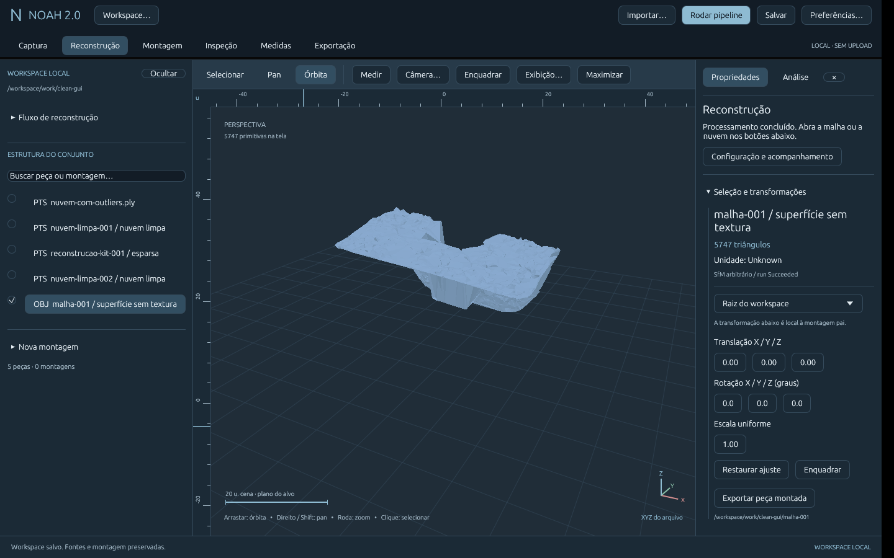

# Preparação, limpeza e superfície derivada — 2026-11-13

## Objetivo e escopo autorizado
Preparar fotografias, tratar outliers e editar a nuvem. Próxima etapa interpretada
e anunciada como geração da superfície da revisão limpa. Incremento E2/E3 e base
para refinamento, sem declarar E6 completa. Máscaras fotográficas, correção de
cor, textura UV, CAD e validação GPU completa seguem no backlog explícito.

## Arquivos e contratos
- geometry/cleaning: seleção XYZ local, SOR e raio com k-NN exato/kd-tree, cores e
  índices mantidos; casos degenerados com pontos coincidentes tratados.
- photogrammetry/preparation: auditoria JPEG/PNG limitada, seleção, cópia ou PNG
  redimensionado, métricas e hashes, verificação/snapshot da proveniência no run.
- storage/cloud_revision: snapshot normalizado, nuvem limpa, índices, fonte/hash
  e receita em novo diretório; verificação da geometria derivada e cadeia de pais.
- workspace: CloudRevision, sessão 7 compatível com 1–6, relatório 4. Run e
  RunSurface podem coexistir como representações explícitas do mesmo run.
- desktop: análise/preparo/filtros em worker, seleção retangular atravessando
  profundidade, caixa, remover/isolar, candidatos vermelhos, aplicar/cancelar,
  comparação, oito operações de desfazer e salvar/abrir revisão. Save workspace
  pede concluir a edição temporária. Original ocultado após abrir revisão.
- surface/model: novo modelo filtrado, observações removidas -1, IDs e índices de
  tracks retidos preservados; restauração BIN e Delaunay sem repetir SfM.
- CLI, guia, kit de outliers e empacotamento Linux. ADR 0012 documenta decisões.
image 0.25.10, já no lock, passa a dependência direta com PNG/JPEG. Textos das
licenças image/zune já incluídos; sem versões novas de terceiros ou motor embutido.

## Comandos e resultados reais
Ambiente Linux x86_64, Rust 1.99.1, X11/Mesa, COLMAP 3.11.1 CPU.

- `cargo fmt --all -- --check`: passou.
- `cargo clippy --workspace --all-targets --locked -- -D warnings`: passou.
- `cargo test --workspace --locked`: **79 testes**, zero falhas.
- `cargo build --workspace --release --locked`: passou.
- `scripts/desktop/package-linux.sh <destino-novo>`: pacote gerado, aberto com
  sessão 7 salva pela interface; fontes/revisões e malha reabertas corretamente.

Cobertura: kd-tree contra busca exaustiva, pontos coincidentes, SOR/raio conhecidos,
caixa/cores, parâmetros inválidos, edição/prévia/desfazer/remoção total recusada,
preparo com JPEG/PNG/duplicatas/exposição e resize, dimensões excedentes,
originais intactos, seleção mínima, adulteração/arquivos extras, revisão
round-trip/encadeada, sessão 7 e fontes antigas, modelo COLMAP filtrado sem índices
deslocados, derivação controlada com proveniência e tamper antes de criar destino.

### Pipeline CLI real
12 fotos sintéticas do kit → auditoria e cópias sem alteração → reconstrução CPU:
12/12 registradas, 7.612 pontos; preparation.json registrado no run.
Em outra reconstrução real de 12 fotos da entrega anterior: SOR k=16, σ=2 removeu
64 de 7.596 pontos → revisão com 7.532 → Delaunay **3.305 vértices / 6.596 faces**.
Hash do manifesto pai coincide com a fonte registrada na revisão após processar.
No exemplo sintético de limpeza, SOR remove exatamente 5/348 pontos, restando 343.

### Pipeline completo pela interface nativa
Fotos do kit → análise → seleção explícita de 11/12 → preparo salvo e entrada
atualizada → COLMAP → 11/11 registradas, **7.262 pontos** → Abrir esparsa → SOR
k=16, σ=2, prévia de **204** → aplicar e salvar revisão com **7.058 pontos** →
Usar run selecionado para gerar malha → somente reutilização de modelo e meshing →
**2.886 vértices / 5.747 faces**. Superfície aberta, fontes anteriores ocultadas
para inspecionar, sessão 7 salva/reaberta no pacote e relatório JSON 4 conferido.
Manifesto pai permanece com seu SHA-256 original. Dataset sintético não valida
qualidade de captura real ou metrologia; contagens SfM variam entre execuções.

No exemplo de 348 pontos: prévia SOR com cinco candidatos, aplicar/desfazer
restaurando 348; seleção retangular dos cinco pontos isolados, remoção e revisão
com 343 pontos verificadas pela interface. No pacote final, SOR → aplicar →
salvar/abrir também conferiu 343 pontos, original ocultado e bloqueio de salvar
workspace enquanto houver edição temporária. Seleção individual das fotos e
salvamento de 11 entradas confirmados no manifesto do preparo.







## Demo reproduzível
Guia: [Preparação e limpeza](../desktop/PREPARO-LIMPEZA.md). No pacote há 12 fotos
e examples/limpeza/nuvem-com-outliers.ply. Sem COLMAP: importe esse PLY → Limpar
nuvem → Editar → SOR k=16, σ=2 → prévia/aplicar/desfazer → nova revisão.
Com motor: preparar fotos → reconstruir/abrir sparse → limpar/salvar revisão →
selecionar revisão → gerar malha CPU em novo run. CLI equivalente:

```sh
noah photos-audit examples/pipeline/fotos
noah photos-prepare examples/pipeline/fotos ./novo-preparo
noah reconstruct ./novo-preparo/images ./novo-run --colmap /caminho/colmap
noah cloud-clean ./novo-run ./nova-revisao --sor 16 2
noah mesh-from-clean ./nova-revisao ./nova-malha --colmap /caminho/colmap
```

## Aceite, limitações e próximos passos
Conforme: preparo com proveniência, edição/filtros com prévia e desfazer,
persistência não destrutiva, nova superfície vinculada a câmeras, pipeline CLI e
UI reais, compilação/testes/pacote. Não há garantia de que todo candidato seja
erro; filtros podem apagar detalhe. Retângulo atravessa profundidade. Até 200 mil
pontos; viewport amostrado. Salvamento usa coordenadas locais, RGB e índices,
não transfere calibração/medidas da sessão ou atributos de sensor não suportados.

JPEG/PNG: limites explícitos e métricas heurísticas; duplicatas somente exatas.
Resize produz PNG sem EXIF, sem autorrotação/correção de cor/máscaras. Novos
intrínsecos são estimados pelo motor. Revisões não são projetos autocontidos;
fontes/chain devem permanecer disponíveis para gerar outra malha.

Malha limpa requer origem sparse de run COLMAP. PLY isolado pode ser editado e
exportado, mas não fornece câmeras. Superfície ainda aproximada, fundo/buracos
possíveis, sem textura UV, fechamento/volume ou precisão garantida. Próximos
passos propostos: máscaras e avaliação fotográfica visual, limpeza mais refinada,
validação dense em GPU, qualidade/textura de superfície; não executados aqui.
