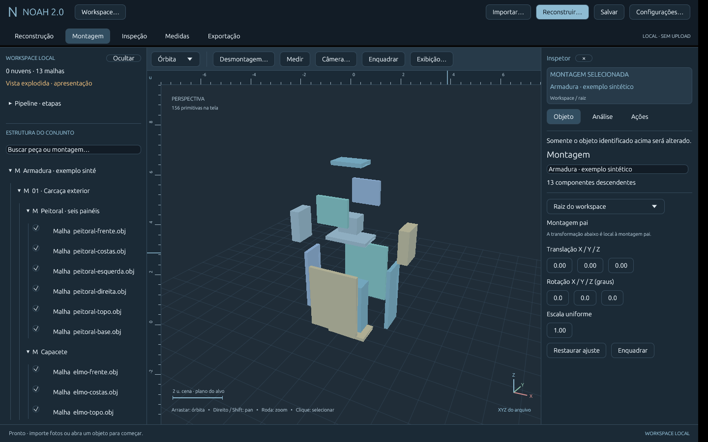
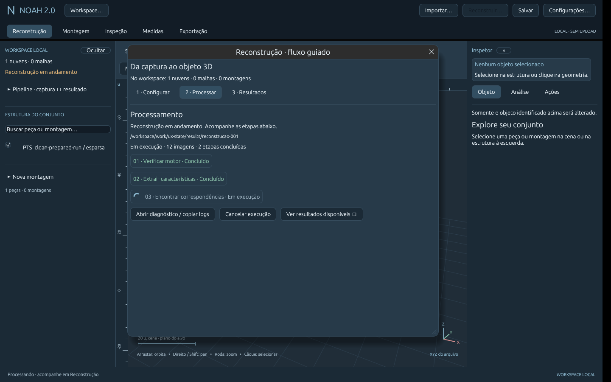
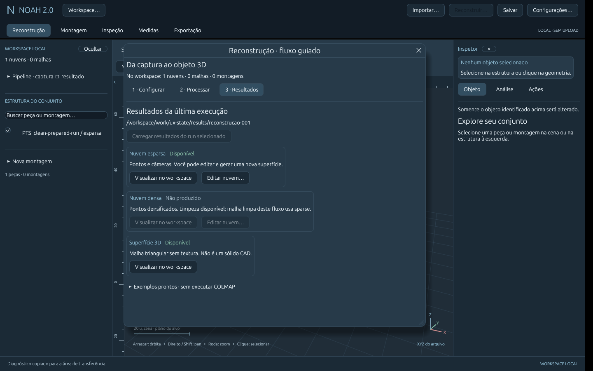
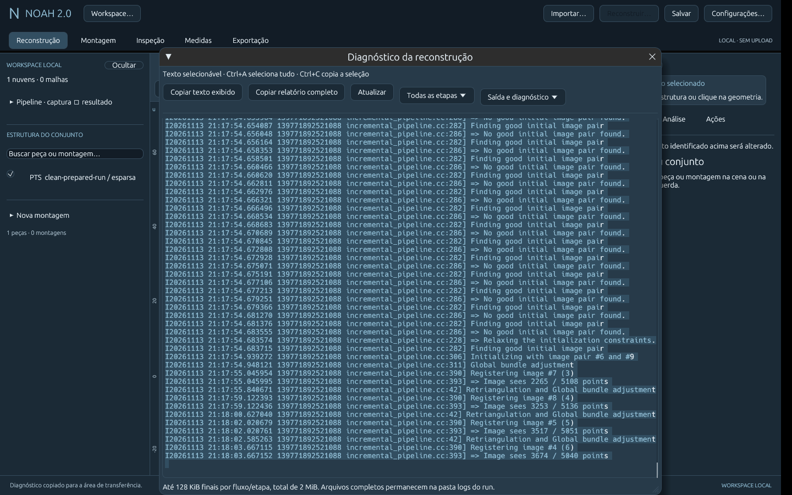
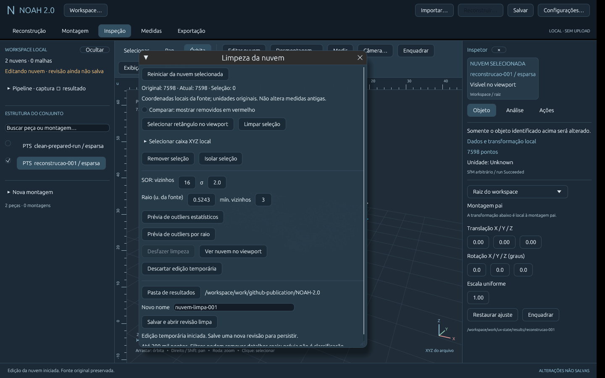
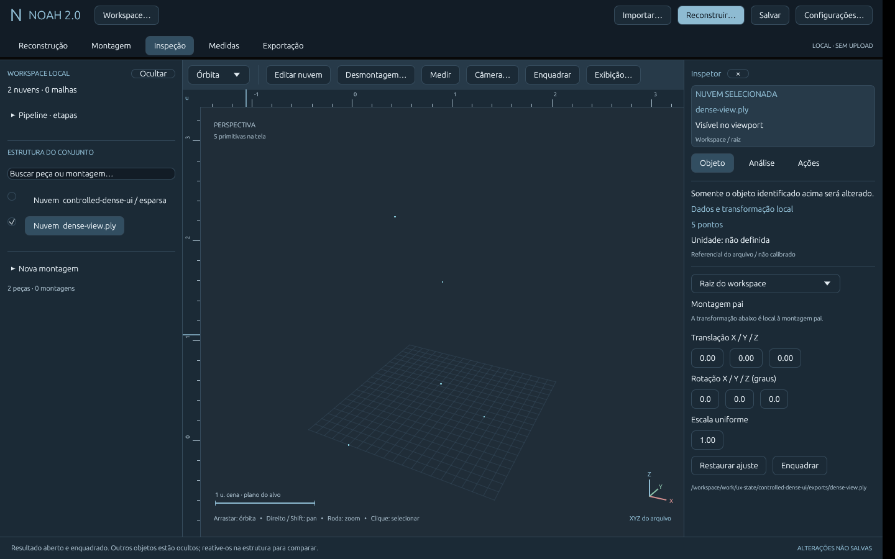
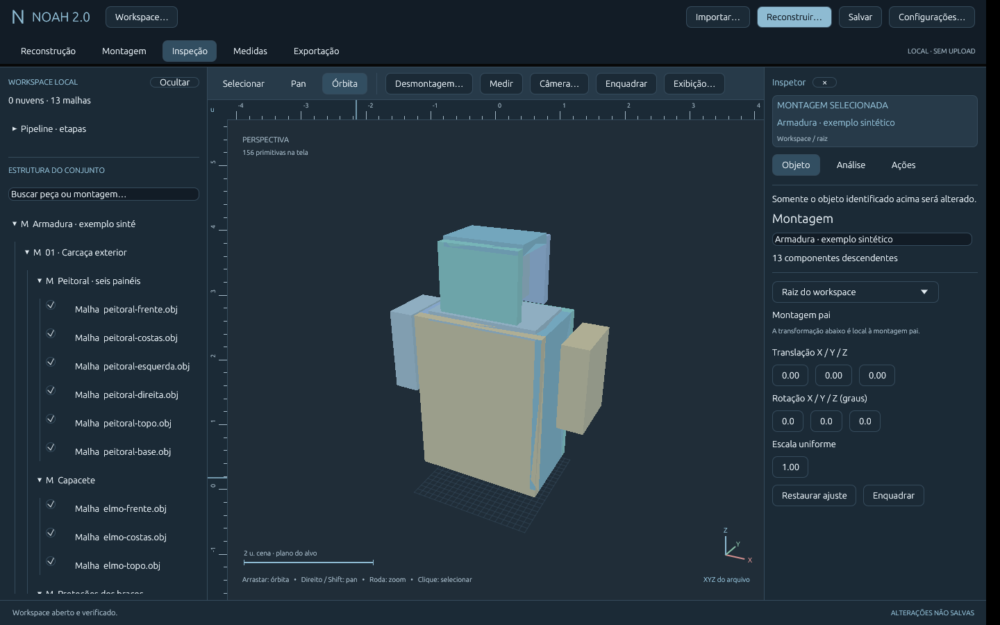
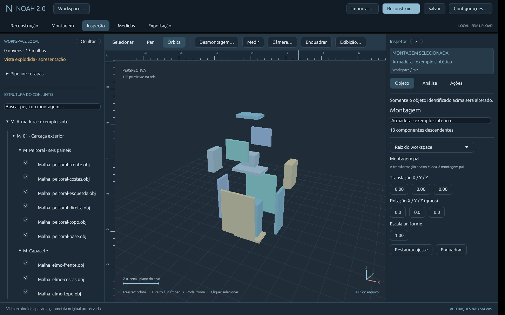
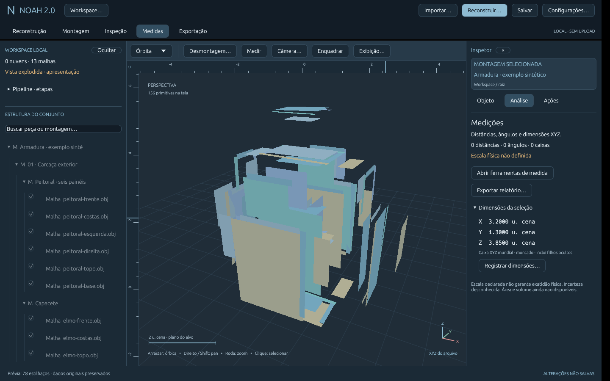

# UX, fluxo guiado e desmontagem — 2026-11-13

## Objetivo e escopo autorizado
Atender aos oito ajustes pedidos, completando este recorte do fluxo desktop.
Não declara concluídos CAD, multissensor, textura ou validação dense GPU.
Plano: ../roadmap/UX-FLUXO-DESMONTAGEM.md; decisão: ADR 0013.

| Pedido | Entrega |
|---|---|
| Log legível, copiável, selecionável | Cabeçalho do run, etapas/status/duração/código, filtros de etapa/fluxo, texto read-only selecionável e duas ações de cópia |
| Pastas independentes | Histórico por finalidade, inclusive preparo/limpeza/exportação, persistido localmente; motor lembrado |
| Menus/etapa/objeto claros | Configurar / Processar / Resultados; estado da cena separado das saídas produzidas; cartões com disponibilidade |
| Edição de nuvens | Entrada por cartão de resultado, toolbar e Ações; seleção/foco e abertura da edição já existente |
| Propriedades identificadas | Nome/tipo/visibilidade/caminho fixos; Objeto / Análise / Ações; propriedades não viram parâmetros de pipeline |
| UX e configurações | Uma entrada visual de pipeline e um botão de execução; motor/histórico em Configurações gerais; parâmetros por execução no passo 1 |
| Visualizar saída realmente | Fecha janela, ativa tipo, seleciona/enquadra e isola saída; reutiliza fonte aberta |
| Explosão/montagem | Ferramenta dedicada, radial/camadas/armadura progressiva, submontagens preservadas no nível, painéis rígidos ou estilhaços; exemplo de carcaça/núcleo |

## Arquivos e decisões
Desktop: preferences/browser, logs/jobs, reconstruction, shell/main, cleaning/
preparation e effects/blast. Workspace: disassembly, assembly/view/session e demo.
Sessão 8 lê 1–7; relatório geométrico permanece 4. Preferências locais schema 1,
XDG_CONFIG_HOME/noah/preferences.json ou ~/.config/noah. Sem dependências novas.

Não há execução automática por lembrar COLMAP ou carregar resultado. Medidas e
exportação usam transformações montadas. Painéis e estilhaços são cache visual;
não mudam assets. Pastas de preparo e limpeza não usam mais o destino da pipeline.

## Verificação executada
Linux x86_64, Rust 1.99.1, X11/Mesa e COLMAP 3.11.1 CPU.

- `cargo fmt --all -- --check`: passou.
- `cargo clippy --workspace --all-targets --locked -- -D warnings`: passou.
- `cargo test --workspace --locked`: **85 testes**, zero falhas.
- `cargo build --workspace --release --locked`: passou.
- Pacote Linux aberto com sessão 8 da armadura: 13 peças/seis montagens, modo
  e profundidade reabertos. Maior requisito glibc do executável: 2.39.

Testes novos: histórico por finalidade e carga/persistência do motor/caminhos;
logs com filtros, ANSI/CR, duração/limites e caminho inválido; preflight com
explicação de conflitos; fronteira hierárquica rígida/profundidade, escopo,
restauração e sessão 8/legado; painéis mantendo faces e restauração exata.
Os 79 testes anteriores de geometria, medições, revisão, parsers e pipeline
continuam passando.

### Pipeline real pela interface
Após selecionar motor, imagens e destino em seletores independentes, a pipeline
real do kit concluiu com **12/12 imagens registradas, 7.598 pontos esparsos,
3.425 vértices e 6.839 faces**. Etapas acompanharam a execução no passo 2 e a
janela mudou para Resultados. Sparse foi aberto, selecionado/enquadrado, a janela
fechou e a fonte anterior ficou oculta. Editar o mesmo resultado reutilizou a
fonte (duas fontes na cena, sem duplicar), abriu edição com 7.598 pontos.

### Logs e clipboard real
O diagnóstico foi selecionado por Ctrl+A/C e copiado também pelo botão. A leitura
do clipboard X11 confirmou **98.362 bytes idênticos**, SHA-256
43e19eb5918c62a9ceacb99a5596401737eec2ddf34333a653d7f33dd0bdf359.
O trecho foi capturado durante o processamento, por isso o cabeçalho registra
estado em execução. Arquivos originais completos permaneceram no run.

### Preferências e reabertura
Interface escolheu motor em colmap-tools, imagens em examples/pipeline/fotos,
resultado em ux-state/results, limpeza em ux-state/cleaned e preparo em
ux-state/prepared. Ao abrir o seletor de imagens após COLMAP, ele iniciou em sua
própria pasta, não no diretório do motor. Os cinco históricos foram conferidos no
JSON; reiniciar restaurou motor/imagens/resultados e a sessão 8. A checagem
mostrou conflito de nome existente; configuração nova sugere próximo nome livre.
Nenhum motor foi executado ao reiniciar.

### Navegação densa controlada
Uma fixture local explicitamente controlada (sem executar densificação) registrou
sparse com quatro pontos e dense-view.ply com cinco. Carregar resultados →
Visualizar nuvem densa fechou a janela, selecionou dense-view.ply, ocultou sparse,
ativou nuvens e enquadrou os cinco pontos. Isso valida navegação, **não** o fluxo
CUDA/GPU de reconstrução, que continua sem validação real neste ambiente.

### Montagem e efeitos nativos
Workspace → Explorar armadura por camadas materializou **13 peças e seis grupos**.
Abertura progressiva revelou núcleo/carcaça e peças; Remontar restaurou o conjunto.
A sessão explodida foi salva como versão 8 e reaberta preservando modo/profundidade.
Os SHA-256 dos 13 OBJ coincidiram com as fontes após as animações.
Painéis gerou **78 placas rígidas** (seis por caixa); faces foram preservadas e a
janela fechou ao animar. Medidas/dimensões no estado montado permaneceram
3,2 × 1,3 × 3,85 unidades da cena, mesmo com apresentação aberta/fragmentada.
Os estilhaços anteriores continuam cobertos pelos testes de cobertura/restauração.

## Capturas

Algumas capturas intermediárias precedem os últimos ajustes de largura/toolbar;
comportamento final conferido no pacote compilado.

## Demo e limites
Guia atual: [UX-GUIA.md](../desktop/UX-GUIA.md). Reconstruir → Configurar com fotos
do kit/COLMAP → Processar/diagnóstico → Resultados/visualizar/editar. Sem motor,
use os exemplos prontos no passo 3. Workspace → Explorar armadura por camadas,
escolha pasta nova → Desmontagem → profundidades 1 e 4, remontar ou painéis.

Conforme: oito ajustes no recorte descrito, testes e validação nativa. Limites:
edição de até 200 mil pontos; visualização amostrada/profundidade aproximada;
logs limitados com arquivos completos preservados. Hierarquia deve existir para
revelar componentes internos; não se inferem peças ocultas. Painéis podem agrupar
regiões desconectadas, sem volume/colisões. Nenhuma precisão física é garantida.
Dense GPU, máscaras fotográficas, texturização e CAD seguem pendentes. Próximos
passos propostos são qualidade de superfície e novas capturas/revisões, sem
implementação especulativa nesta entrega.
